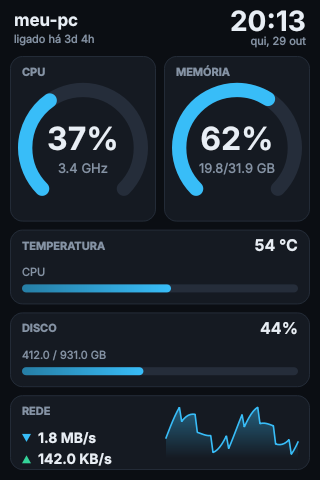
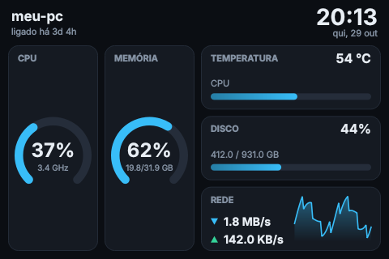
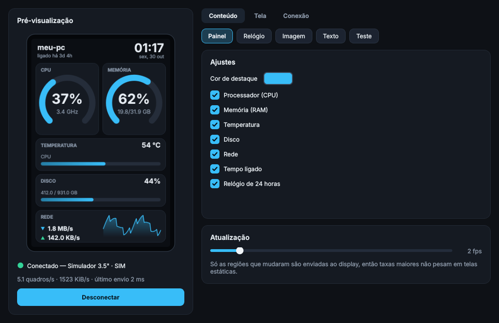

# 35inch-qt

Interface em Qt (PySide6) para o display USB de 3.5" chinês **UsbMonitor** (`1a86:5722`, QinHeng) no Linux.
Uma alternativa ao programa do Windows: pré-visualização ao vivo, painel de sistema, relógio, imagem, texto,
brilho e orientação, com tema escuro.

| Painel (retrato) | Painel (paisagem) | Relógio |
|---|---|---|
|  |  |  |



> **Status do hardware:** o protocolo foi implementado a partir do protocolo público dos displays *Turing Smart Screen
> Rev. A / UsbMonitor* e verificado contra um **simulador** do display (os testes conferem byte a byte que o que sai
> pela serial reconstrói a imagem). Ainda **não foi testado num aparelho físico**. No primeiro uso, confira a
> orientação com *Conteúdo › Teste › Orientação* e, se o brilho funcionar ao contrário, marque
> *Tela › Inverter a escala do brilho*.

## Recursos

- **Pré-visualização** em tempo real, igual ao que vai para a tela.
- **Cenas:** Painel (CPU, memória, temperatura, disco, rede com gráfico), Relógio, Imagem (caber/preencher/esticar),
  Texto livre e Padrões de teste (orientação, barras, degradês, grade).
- **Controles do aparelho:** brilho, liga/desliga tela, limpar, reiniciar, 4 orientações.
- **Envio parcial:** só as regiões que mudaram vão pela serial. Medido em 60 quadros simulados: o relógio envia em
  média ~5 KiB por atualização (contra 300 KiB de um quadro inteiro, ~98% a menos) e o painel de sistema ~208 KiB
  (~31% a menos), já que o gráfico de rede e os anéis mudam a cada segundo.
- **Conexão robusta:** detecta o aparelho por `1a86:5722`, reconecta sozinho se o cabo for puxado, mensagens de erro
  que dizem o que fazer (por exemplo, falta de permissão na porta).
- **Modo simulador** (`--simulate`) para usar a interface sem o hardware.
- Toda a E/S serial roda numa thread separada; a interface não trava se o display demorar.

## Instalação

```bash
git clone https://github.com/chespinowo/35inch-qt.git
cd 35inch-qt
python3 -m venv .venv && source .venv/bin/activate
pip install -e .
```

Requer Python 3.10+. Em algumas distribuições o Qt precisa de `libxcb-cursor0` (Debian/Ubuntu) para abrir a janela.

### Permissão na porta serial (uma vez)

```bash
sudo cp udev/60-usbmonitor.rules /etc/udev/rules.d/
sudo udevadm control --reload && sudo udevadm trigger
```

Depois desconecte e conecte o display. A regra também impede o ModemManager de "sondar" o aparelho. Alternativa:
`sudo usermod -aG dialout $USER` e **sair e entrar na sessão** (o grupo novo só vale em logins novos).

### "Sem permissão para abrir /dev/ttyACM0"

```bash
ls -l /dev/ttyACM0     # dono/grupo e permissões da porta
id -nG                 # seus grupos: "dialout" (Debian/Ubuntu) ou "uucp" (Arch/Fedora) deveria aparecer
getfacl /dev/ttyACM0   # com a regra udev ativa, deve haver "user:SEU_USUARIO:rw-"
```

- A regra tem de se chamar `60-…` (antes de `73-seat-late.rules`); com prefixo maior a etiqueta `uaccess` não funciona.
- Após instalar a regra é preciso **replugar** o display; `udevadm trigger` sozinho nem sempre reaplica a um aparelho já conectado.
- Para testar na hora, sem instalar nada: `sudo setfacl -m u:$USER:rw /dev/ttyACM0` (vale até desconectar o cabo).
- Em Arch/Fedora o grupo é `uucp`: ajuste `GROUP=` na regra e use `usermod -aG uucp`.

## Uso

```bash
usbmonitor-qt                      # detecta o aparelho automaticamente
usbmonitor-qt --port /dev/ttyACM0  # porta específica
usbmonitor-qt --simulate           # sem hardware
usbmonitor-qt --list-ports         # lista as portas seriais e sai
```

Para um atalho no menu de aplicativos, copie `packaging/35inch-qt.desktop` para `~/.local/share/applications/` e
`packaging/35inch-qt.svg` para `~/.local/share/icons/hicolor/scalable/apps/`.

## Protocolo (resumo)

Serial 115200 8N1 com `rtscts`. Todo comando começa com um cabeçalho de 6 bytes que empacota quatro coordenadas de
10 bits e o byte do comando; imagens seguem como RGB565 little-endian. Os detalhes e o código de referência estão em
[`src/usbmonitor_qt/protocol.py`](src/usbmonitor_qt/protocol.py). A descrição do protocolo vem do projeto
[turing-smart-screen-python](https://github.com/mathoudebine/turing-smart-screen-python) (GPL-3.0), consultado como
documentação; o código deste repositório é independente e licenciado sob MIT.

## Desenvolvimento

```bash
pip install -e ".[dev]"
pytest                              # 35 testes; usam a plataforma Qt "offscreen" e o simulador
python scripts/make_screenshots.py  # regenera as imagens de docs/
```

Estrutura: `protocol.py` (bytes, sem Qt) · `device.py` (serial real e simulador) · `sender.py` (diferença entre
quadros) · `scenes.py` (o que é desenhado) · `worker.py` (thread de E/S) · `mainwindow.py` (interface).

## Licença

MIT. Veja [LICENSE](LICENSE).
